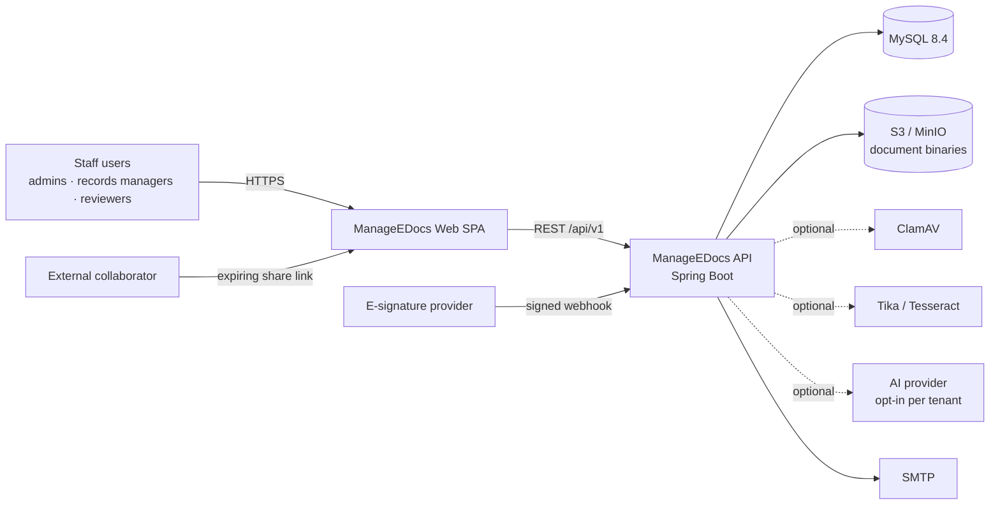
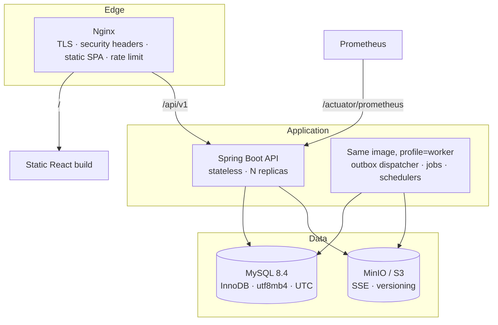
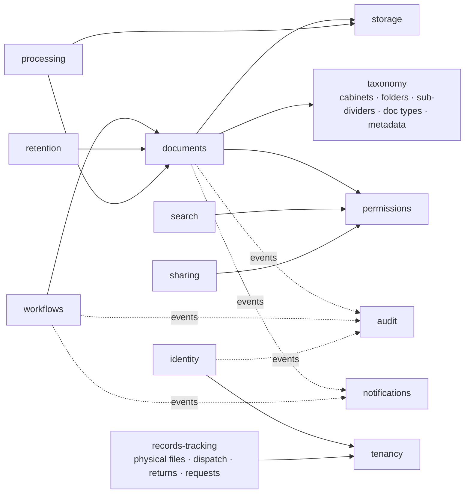
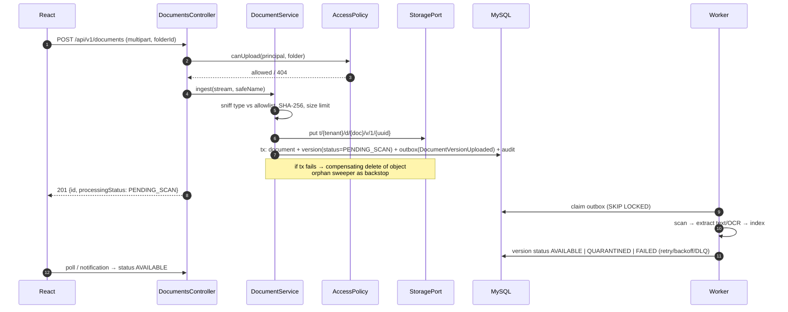
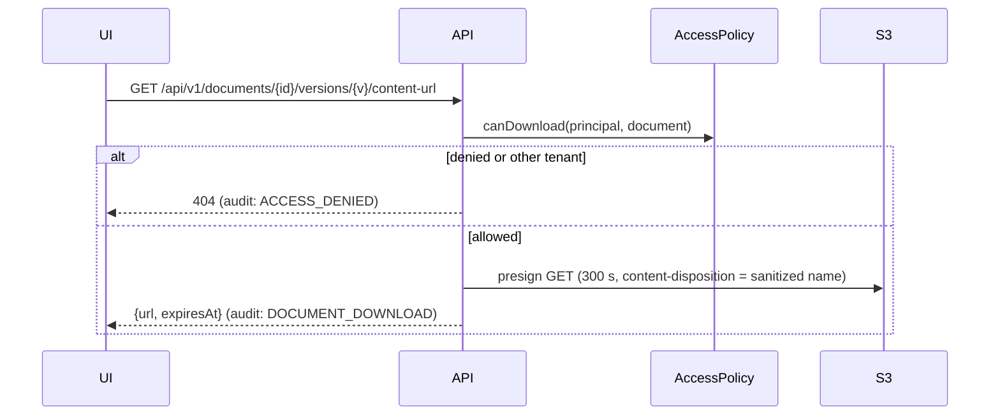
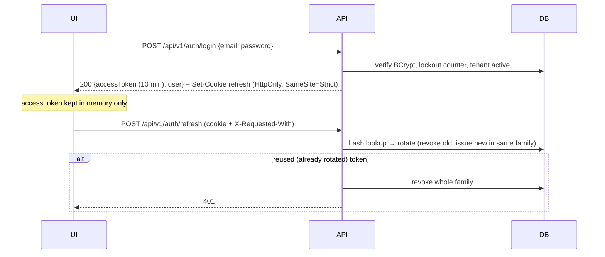
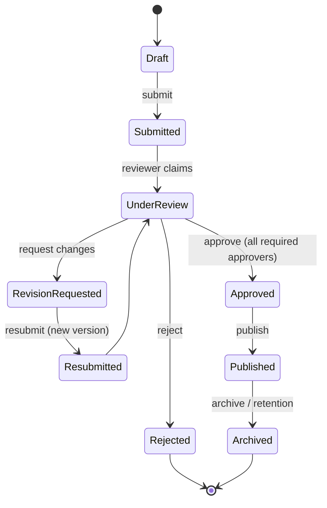
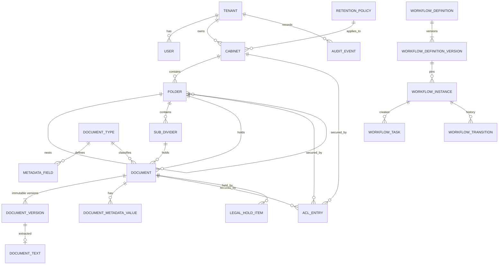

# ManageEDocs: Target System Architecture

Status: **target**. The NestJS app in `apps/api` is the current production system. The Spring Boot backend in `backend/` is being built towards this design. Decisions are recorded in [architecture-decisions.md](architecture-decisions.md).

## 1. System context

## 2. Containers and deployment

The API and worker run from one artifact with two profiles, so scaling does not need a broker (ADR-007).

## 3. Backend modules

| Module | Responsibility |
|---|---|
| `identity` | Login, refresh rotation, lockout, password reset, MFA (later), current principal |
| `tenancy` | Tenants (formerly BusinessUnit), branches/departments, tenant settings, tenant context |
| `users` | User lifecycle, roles, groups |
| `permissions` | RBAC + resource ACLs (cabinet/folder/document), central `AccessPolicy` |
| `taxonomy` | Cabinets (Personal/Private/Default), folders, sub-dividers, document types, metadata schemas, tags |
| `documents` | Logical document, immutable versions, check-in/out locks, lifecycle state machine |
| `storage` | `StoragePort` + S3 adapter, presigned URLs, reconciliation |
| `processing` | Outbox, job runner, scan/extract/index pipeline, retries, dead letters |
| `search` | FULLTEXT + metadata search, facets, saved searches, permission-filtered |
| `workflows` | Versioned definitions, instances, tasks, transitions, delegation, deadlines |
| `retention` | Policies, legal holds, disposition runs with dry-run and approval |
| `sharing` | Internal shares, expiring external links |
| `audit` | Append-only hash-chained events, query and export |
| `notifications` | In-app and email notifications |
| `reporting` | Dashboard metrics and reports (xlsx/pdf), all tenant- and permission-scoped |
| `records` | Ported Part A: physical file inventory, dispatch/return, movements, requests |

## 4. Document ingestion

## 5. Retrieval and download

## 6. Authentication

## 7. Approval workflow (default definition)

## 8. Core data model (abridged)

## 9. Security boundaries

- The browser holds only an in-memory access token. It never holds storage credentials or receives internal paths.
- Every controller method runs through Spring Security, and authorisation decisions go through `AccessPolicy`. Tenant comes from the principal (ADR-004).
- Not-found and forbidden responses are indistinguishable for cross-tenant resources.
- Uploads are validated by content, scanned before they become `AVAILABLE`, and stored under server-generated keys.
- Logs never contain tokens, passwords, presigned URLs or document text.
